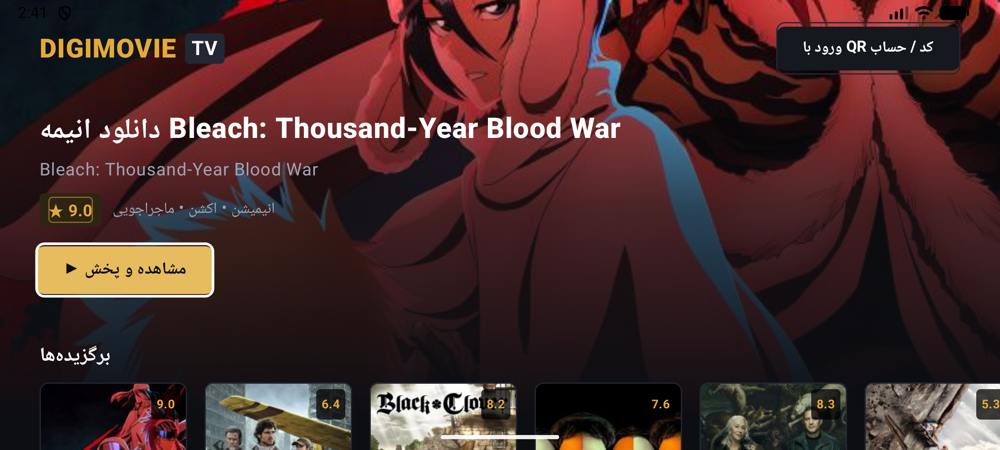
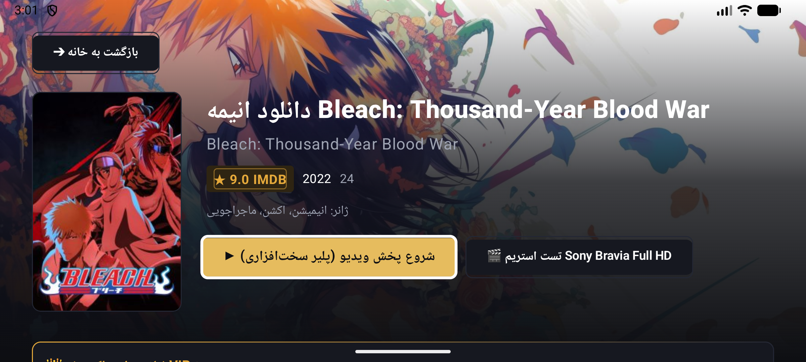
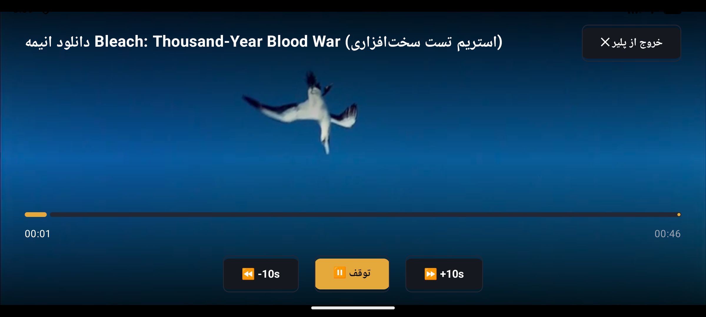
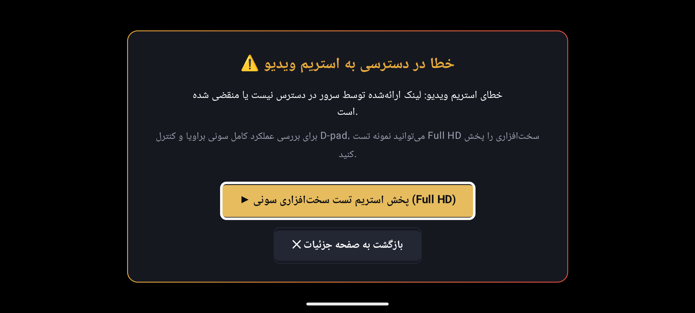
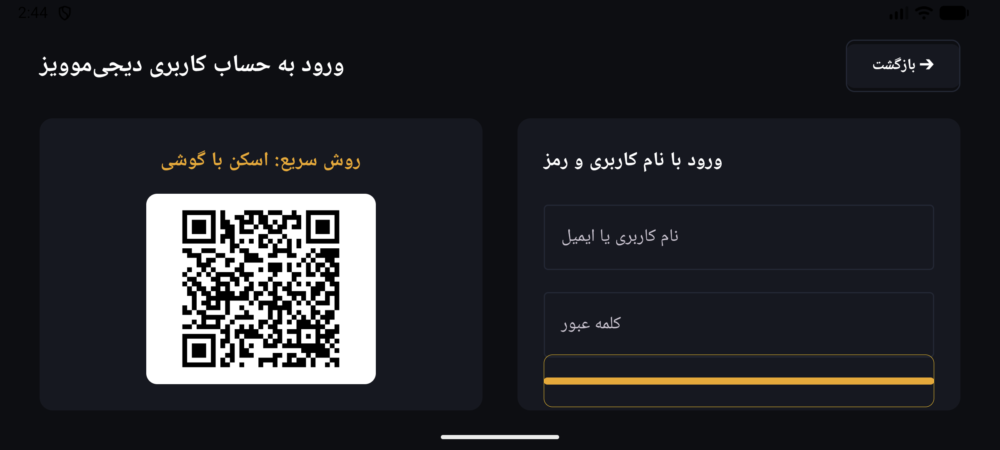

# DigiMovies+ (دیجی‌موویز پلاس) 🎬📺

<p align="center">
  
</p>

<p align="center">
  
  
  
  
  
</p>

---

## 🌟 Overview

**DigiMovies+** is an ultra-modern, high-performance Android TV / Google TV client engineered specifically for 10-foot living-room experiences, with tailored hardware acceleration for **Sony Bravia 4K Smart TVs**.

Built from scratch using **Jetpack Compose for TV**, **Media3 ExoPlayer**, and Persian RTL design patterns, DigiMovies+ delivers 100% remote D-pad navigability, instant catalog browsing, and resilient hardware video playback.

---

## ✨ Features

- **📺 10-Foot Leanback UI with Persian RTL Typography**:
  - High-contrast typography and golden accents (`#FFD54F`) designed for clear visibility from couch distance.
  - Smooth scale transitions (1.10x) and golden borders when moving focus between movie cards.
- **⚡ Dynamic Hero Backdrop**:
  - The hero backdrop, title, IMDb rating, and genre tags automatically and smoothly update as the user browses through showcase carousels via D-pad navigation.
- **🎥 Sony Bravia Hardware Video Player (`SurfaceView`)**:
  - Direct native `SurfaceView` integration utilizing Media3 ExoPlayer with hardware codec fallback (`EXTENSION_RENDERER_MODE_ON`).
  - Tuned Sony Bravia buffer controls: 15s minimum buffer, 50s maximum buffer, and 2.5s instant startup threshold.
  - Sony Bravia 4K TV User-Agent to prevent CDN blocking or throttling.
- **🎮 100% Remote D-pad Interactivity**:
  - Full support for TV remote controls (`DPAD_UP`, `DPAD_DOWN`, `DPAD_LEFT`, `DPAD_RIGHT`, `DPAD_CENTER`, `BACK`, and dedicated Media keys).
  - Quick ±10s seeking on horizontal D-pad taps.
  - Play / Pause toggling on center clicks.
  - Automatic 4-second auto-hiding HUD with instant wake-up on any D-pad motion.
- **🛡️ Resilient Stream Recovery & Hardware Fallback**:
  - Intelligent detection of expired third-party CDN trailer links or 404 responses.
  - Automatically pops up an in-app Persian TV modal with a 1-click auto-focused retry on a high-bitrate Sony Bravia hardware stream.
- **📱 Smart Phone QR Code & TV Login**:
  - Instant login using smartphone camera QR scanning (`/auth/tv?session=...`).
  - Optional on-screen credentials input with D-pad focus management.

---

## 📸 Screenshots

| 🏠 Home Showcase & Dynamic Hero | 📄 Movie / Series Details |
|:---:|:---:|
|  |  |

| 🎬 Hardware Video Player (SurfaceView) | ⚠️ Stream Fallback Error Modal |
|:---:|:---:|
|  |  |

| 📱 Mobile QR Code & Remote Login |
|:---:|
|  |

---

## 🛠️ Tech Stack & Architecture

- **Language & Runtime**: Kotlin 2.0.21 on Android 14+ (API 34/36).
- **UI Toolkit**: Jetpack Compose TV, Material 3, Compose Foundation.
- **Media Engine**: AndroidX Media3 ExoPlayer 1.5.1 with Direct `SurfaceView`.
- **Networking**: Retrofit 2.11.0, OkHttp 3 Logging Interceptor, Gson.
- **Image Pipeline**: Coil 2.7.0 for Compose with crossfade and disk caching.
- **QR Engine**: QRGen 2.0 with ZXing core for TV QR authentication codes.
- **Architecture**: Clean MVVM / MVI with `StateFlow` and unidirectional event handling.

---

## 🚀 Building & Running

### Prerequisites
- Android Studio Ladybug or newer.
- Android SDK 34+.
- Java Development Kit (JBR / JDK 17 or 21).

### Build Debug APK
```bash
# Clone the repository
git clone https://github.com/armanpier/digimovies-plus.git
cd digimovies-plus

# Build debug APK
./gradlew assembleDebug
```

### Install onto Sony Bravia / Android TV
```bash
# Connect to your Android TV via adb
adb connect <TV_IP_ADDRESS>:5555

# Install the APK
adb install -r app/build/outputs/apk/debug/app-debug.apk

# Launch the app
adb shell am start -n com.digimovie.tv/.MainActivity
```

---

## 🎮 Virtual Remote Control (ADB Testing)

You can simulate all physical Android TV remote buttons directly with ADB:

```bash
# D-pad Navigation
adb shell input keyevent 19 # DPAD_UP
adb shell input keyevent 20 # DPAD_DOWN
adb shell input keyevent 21 # DPAD_LEFT (Seek -10s in Player)
adb shell input keyevent 22 # DPAD_RIGHT (Seek +10s in Player)
adb shell input keyevent 23 # DPAD_CENTER (Select / Play-Pause)

# Back Key
adb shell input keyevent 4  # KEYCODE_BACK
```

---

## 📄 License
This project is open-source and intended for educational and personal streaming on Android TV devices.
All movie and series metadata belong to their respective content owners.
